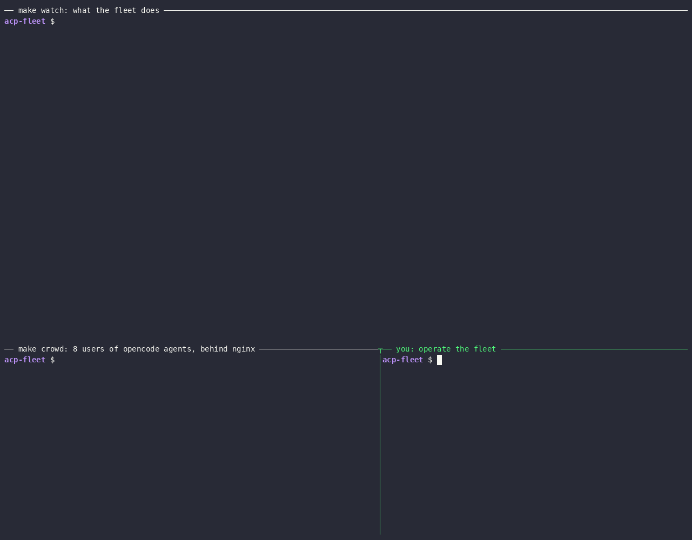

# ACP fleet

**Coding agents behind a load balancer that survive crashes.** Kill a server mid-conversation: the agent's memory, its files and its pending questions continue on another server.



Three a2a-go servers run [opencode](https://opencode.ai) agents with the [`a2aacp`](https://pkg.go.dev/github.com/a2aproject/a2a-go/v2/integrations/executor/a2aacp) executor in [a2a-go](https://github.com/a2aproject/a2a-go) cluster mode, behind nginx with no sticky sessions. NATS coordinates them and MySQL indexes tasks.

## Quick start

```console
export GEMINI_API_KEY=...   # https://aistudio.google.com/apikey
make up-opencode            # NATS, MySQL, 3 servers, nginx on :8080
make watch                  # terminal 1: the live view
make crowd N=8              # terminal 2: 8 users that check what their agents remember
```

No key? `make up` runs a [fake agent](internal/fakeacp/fakeacp.go) instead.

## Break it

```console
make kill S=server-2        # crash: its shards move once its heartbeat expires
make join                   # scale out: server-4 takes about a quarter of the shards
make drain S=server-3       # graceful: running turns finish, then its shards move
```

`watch` shows every move, and the crowd checks that the agents still know their user's code and file:

```text
16:19:20 server-3 took 15 shards from server-2 (crashed), 3 conversations
16:19:20 alice's turn stopped with server-2; the message is sent again
16:19:28 ✓ alice's agent remembers the code on server-3 after moving from server-2
```

## Highlights

- **Virtual shards and rendezvous hashing.** Conversations [hash into 64 shards](internal/shards/assign.go#L16), and each shard [goes to the highest-scoring live server](internal/shards/assign.go#L25). A join or a crash moves only the shards of the server that changed.
- **Any server takes any request.** The [router](internal/router/router.go#L82) runs a message on the owner of its shard or forwards it there over NATS.
- **Fenced ownership.** Each shard record carries an owner, an incarnation and an epoch, and every [claim](internal/shards/manager.go#L178) and save is a [compare-and-swap](internal/shards/table.go#L160). A server that [can't renew its heartbeat](internal/nodes/nodes.go#L149) exits before others take over. A paused server can't overwrite the new owner's record.
- **Snapshots after every turn.** The agent's home and scratch directory are [saved when each turn ends](internal/agents/agents.go#L148), so a crash loses only the turn in flight. The next owner [restores them on the conversation's next message](internal/shards/shard.go#L108), and opencode resumes its session.
- **Delta uploads.** Snapshots are [content-defined chunks](internal/shards/chunker.go#L64) named by their SHA-256 and compressed one by one. A [save uploads only the new chunks](internal/shards/snapshot.go#L101), about 100 KB of a 5 MB agent home per turn. Unused chunks are deleted [after each save](internal/shards/shard.go#L196), and [when a shard is claimed](internal/shards/shard.go#L389).
- **Graceful drain.** A [draining server](internal/server/server.go#L210) lets running turns finish, [stops the shard's agents](internal/agents/agents.go#L208) and [hands over its scratch directories](internal/shards/shard.go#L282).
- **No stuck clients.** When a server dies, its successor [fails the tasks it left unfinished](internal/tasks/tasks.go#L46), so clients send them again.
- **Proof, not anecdotes.** The [crowd](internal/crowd/crowd.go#L88) checks every agent's memory as the fleet changes, and [watch](internal/watch/watch.go#L42) draws the fleet from the `fleet.events` NATS subjects.

## What a shard holds

| | Where | Moves on drain | Survives a crash |
| --- | --- | --- | --- |
| Session map | `sessions.db` (SQLite) | yes | snapshot of the last turn |
| Agent home | `homes/<context>` | yes | snapshot of the last turn |
| Scratch | `scratch/<context>`, the agent's working directory | yes | snapshot of the last turn, up to 64 MiB |
| Tasks | MySQL and NATS ([`integrations`](../../integrations)) | shared | shared |

Snapshots live in the `SHARD_DATA` object store, and the `SHARDS` KV bucket points at them.

## More

- `make chat` talks to the fleet with the [a2a CLI](https://github.com/a2aproject/a2a-cli) v0.4.0 or later. `make status` lists shard owners. `make test` runs the integration tests.
- [`demo/record.sh`](demo/record.sh) records the GIF above with tmux, asciinema 3 and agg.
- The fake agent understands `save <note>` (asks permission), `scratch <text>`, `work <seconds>`, `fill <file> <KiB>` and `size <file>`.

## Configuration

Set in [`infra/docker-compose.yaml`](infra/docker-compose.yaml):

| Variable | Default | Meaning |
| --- | --- | --- |
| `FLEET_MODEL` | `google/gemini-3-flash-preview` | opencode's model, set by `make up-opencode` |
| `AGENT_COMMAND` | the fake agent | The ACP agent's command line; the opencode image sets it |
| `SHARDS` | `64` | Number of shards; all servers must agree |
| `IDLE_TIMEOUT` | `1m` | Stops agents with no turns for this long |
| `DRAIN_TIMEOUT` | `1m` | How long a moving shard waits for its turns |
| `MAX_AGENTS` | `8` | Agents per server |
| `SCRATCH_LIMIT_MB` | `64` | Larger scratch directories move only on a graceful move |

## Limitations

- A server that dies after a turn ends but before its snapshot lands loses that turn's memory.
- A paused server can still run its agent's tools until it notices it lost the shard.
- Agents share their server's container with no sandbox. opencode asks before bash and allows its other tools.
- A snapshot holds at most 256 MiB. Conversations unused for 7 days are deleted when their shard next moves.
- Clients, NATS and MySQL aren't authenticated.
